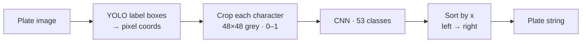

<h1 align="center">🚗 Nepali Number Plate Recognition</h1>

<p align="center">Reads Nepali registration plates character by character: English letters, English and Nepali digits, and compound Devanagari characters such as का, ना, को and बा.</p>

<p align="center">
  
  
  
  
</p>

<table>
  <tr>
    <td width="45%"><br><sub><b>Characters located</b> (YOLO boxes)</sub></td>
    <td width="55%"><br><sub><b>Each crop classified</b></sub></td>
  </tr>
</table>

## How it works



| | |
|---|---|
| **Character set** | 53 classes, one folder each, 30 114 images, loaded with PIL so Unicode folder names work |
| **Training** | Adam · categorical cross-entropy · 15 epochs · batch 64 · 80 / 20 split → `char_cnn.h5` |
| **Plates** | Full plate images with YOLO-format `.txt` labels |

<table>
  <tr>
    <td width="60%"><br><sub><b>Training curves</b></sub></td>
    <td width="40%"><br><sub><b>Confusion matrix</b></sub></td>
  </tr>
</table>

<details>
<summary><b>Dataset samples, model summary and more results</b></summary>
<br>


<br>
<br>
<br>

</details>

## Run it

```bash
pip install tensorflow opencv-python pillow numpy matplotlib scikit-learn
jupyter notebook Main2.ipynb
```

Set `CHAR_DATASET`, `MODEL_DIR`, `PLATE_IMAGES` and `LABELS_PATH` (currently `E:\NumberPlateRecognition\...`) at the top.

## Status & known issues

| Issue | Effect |
|---|---|
| **Character boxes come from ground-truth YOLO label files, not a detector** | This is recognition only. A new photo without a `.txt` label can't be read |
| Characters are sorted by x only | Two-row plates (common in Nepal) come out with the rows interleaved |
| The notebook has no saved outputs, and no test accuracy is stated | The only results are the images above |
| Dataset and `char_cnn.h5` not in the repo | Training and inference can't be reproduced as cloned |
| Per-character classification | No language model, so errors such as a `0` vs `०` mix-up aren't caught |

## Roadmap

- [ ] Train a YOLOv8 character / plate detector to make it end to end
- [ ] Row clustering (by y) before the left-to-right sort
- [ ] Report test accuracy and per-class F1; augment rare compound characters
- [ ] CRNN + CTC for whole-plate reading; real-time video demo
